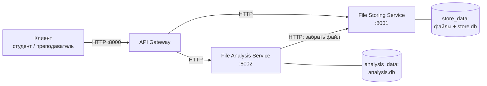
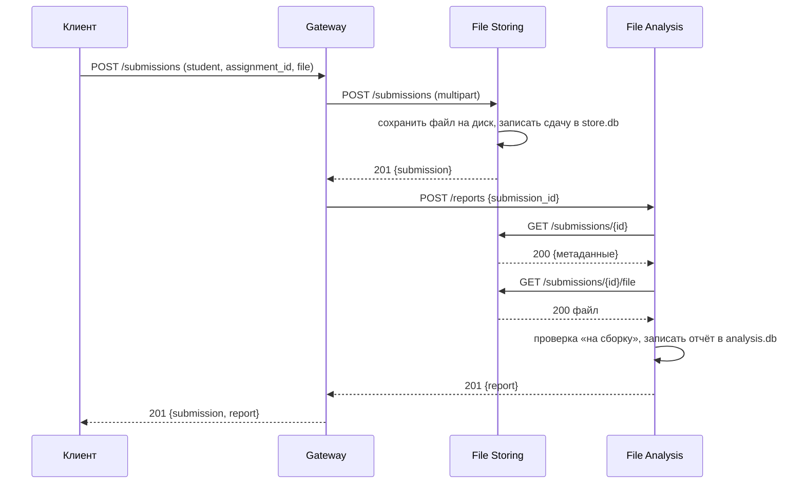

# ВышBuild — проверка сдач домашних работ «на сборку»

ДЗ-3 по КПО: микросервисная серверная часть с синхронным взаимодействием.
Студент загружает работу → система сохраняет файл → сразу синхронно проверяет его «на собираемость» →
сохраняет отчёт. Преподаватель смотрит сводку по заданию: у кого зелёный билд, у кого красный.

Стек: Python 3.12, Flask, requests, SQLite (у каждого сервиса своя), Docker Compose.

## Запуск

```bash
docker compose up --build
```

- API: `http://localhost:8000`
- Swagger UI: `http://localhost:8000/docs`
- Postman: импортировать `postman/VyshBuild.postman_collection.json`
- Файлы для пробных сдач: папка `examples/`

Быстрая проверка из консоли:

```bash
curl -X POST http://localhost:8000/submissions \
  -F student="Иванов Иван" -F assignment_id=hw-1 -F file=@examples/good_python_project.zip

curl http://localhost:8000/assignments/hw-1/reports
```

## Архитектура



Наружу открыт только порт gateway (8000). Сервисы общаются по внутренней сети Docker Compose
по именам `file-storing` и `file-analysis`.

```
gateway/                  API Gateway (порт 8000)
  app.py                  маршрутизация, сценарий сдачи, обработка недоступности сервисов
  openapi.yaml            спецификация для Swagger
file_storing_service/     File Storing Service (порт 8001)
  app.py                  хранение файлов и записей о сдачах
file_analysis_service/    File Analysis Service (порт 8002)
  app.py                  запуск проверки, хранение и выдача отчётов
  checks.py               алгоритм «проверки на сборку»
postman/                  Postman-коллекция
examples/                 файлы для демонстрации
docker-compose.yml
```

### Как разрезаны ответственности

| Сервис | Что делает | Что хранит | Чего НЕ делает |
|---|---|---|---|
| **File Storing Service** | принимает файл, фиксирует сдачу (кто, когда, задание), отдаёт метаданные и сам файл | файлы на диске + `store.db` (таблица `submissions`) | не анализирует, ни к кому не ходит |
| **File Analysis Service** | проверяет сдачу «на сборку», хранит отчёты, отдаёт отчёты и сводку по заданию | `analysis.db` (таблица `reports`) | не хранит файлы: за файлом ходит в File Storing |
| **API Gateway** | единая точка входа: маршрутизирует запросы и оркестрирует сценарий «сохранить → проверить», превращает падения сервисов в понятные ответы | ничего | не хранит данные, не содержит бизнес-логики проверки |

Запись о сдаче (submission) живёт в File Storing, потому что это и есть факт загрузки артефакта:
кто, когда, по какому заданию и где файл. Отчёт хранит копию `student` и `assignment_id`, чтобы сводку
по заданию можно было построить без похода в File Storing — сводка работает, даже когда File Storing лежит.

У каждого сервиса **свой volume и своя база**: общей БД нет, данные одного сервиса другой видит
только через его HTTP API.

## User flow

1. **Студент** сдаёт работу: `POST /submissions` с полями `student`, `assignment_id`, `file`.
   В ответ сразу получает и запись о сдаче, и отчёт проверки.
2. **Преподаватель** смотрит сводку по заданию: `GET /assignments/{assignment_id}/reports` —
   статус каждой сдачи (`success` / `failed`) и итог: сколько всего, сколько собралось и сколько нет.

Дополнительно: посмотреть сдачу, скачать файл, посмотреть отчёты сдачи или отчёт по id,
повторно запустить проверку (если в момент сдачи анализ был недоступен).

### API Gateway (для клиентов)

| Метод | Адрес | Что делает | Куда ходит |
|---|---|---|---|
| POST | `/submissions` | сдать работу: сохранить + проверить | Store, затем Analysis |
| POST | `/submissions/{id}/analyze` | повторить проверку сдачи | Store, затем Analysis |
| GET | `/submissions/{id}` | информация о сдаче | Store |
| GET | `/submissions/{id}/file` | скачать файл | Store |
| GET | `/submissions/{id}/reports` | все отчёты сдачи | Analysis |
| GET | `/reports/{id}` | отчёт по id | Analysis |
| GET | `/assignments/{assignment_id}/reports` | сводка по заданию | Analysis |
| GET | `/health` | состояние всех сервисов | Store и Analysis |
| GET | `/docs` | Swagger UI | — |

### Внутренние API сервисов

| Сервис | Метод | Адрес | Что делает |
|---|---|---|---|
| File Storing | POST | `/submissions` | сохранить файл и запись о сдаче (multipart) |
| File Storing | GET | `/submissions/{id}` | метаданные сдачи |
| File Storing | GET | `/submissions/{id}/file` | файл |
| File Analysis | POST | `/reports` | `{"submission_id": "..."}` → проверить и сохранить отчёт |
| File Analysis | GET | `/reports/{id}` | отчёт |
| File Analysis | GET | `/submissions/{id}/reports` | отчёты сдачи |
| File Analysis | GET | `/assignments/{assignment_id}/reports` | сводка по заданию |
| оба | GET | `/health` | жив ли сервис |

## Сценарий сдачи end-to-end



Пошагово:
1. Клиент отправляет в Gateway `POST /submissions` (multipart: `student`, `assignment_id`, `file`).
2. Gateway синхронно пересылает файл и поля в File Storing: `POST /submissions`.
3. File Storing проверяет поля, сохраняет файл под сгенерированным id (не под именем от пользователя —
   так нельзя подсунуть путь вроде `../../`), пишет сдачу в `store.db` и возвращает `201` с данными сдачи.
4. Gateway синхронно вызывает File Analysis: `POST /reports` с `submission_id`.
5. File Analysis сам забирает у File Storing метаданные сдачи и файл (два GET-запроса).
6. File Analysis прогоняет проверку, сохраняет отчёт в `analysis.db` и возвращает `201` с отчётом.
7. Gateway отвечает клиенту `201 {"submission": ..., "report": ...}`.

Сводка для преподавателя: Gateway → `GET /assignments/{id}/reports` в File Analysis → ответ клиенту.

## Что происходит, если сервис недоступен

Все вызовы между сервисами идут с таймаутом (gateway — 30 с, analysis → storing — 10 с; задаётся
переменной `REQUEST_TIMEOUT`). Если сервис не запущен, упал или завис дольше таймаута, клиент получает
**JSON с кодом 503 и понятным текстом**: какой сервис и что с ним. Все остальные ошибки (404, 405,
413, 500) тоже отдаются в JSON, а не HTML-страницей.

| Ситуация | Что видит клиент |
|---|---|
| **File Storing недоступен** при сдаче | `503 {"error": "File Storing Service недоступен (не запущен или упал)", "service": "file_storing"}`. Сдача **не** сохранена, ничего не создано |
| **File Analysis недоступен** при сдаче | `503 {"error": "Работа сохранена, но проверка не выполнена: File Analysis Service недоступен ...", "submission": {...}, "report": null, "retry": "POST /submissions/<id>/analyze"}`. Файл **сохранён**, отчёта нет. Когда сервис поднимется, проверку можно повторить по адресу из `retry` |
| File Storing упал **во время** анализа | File Analysis не может забрать файл и отвечает `503`, Gateway отдаёт клиенту `503` с сохранённой сдачей и `retry` |
| Сервис завис (жив, но не отвечает) | `503 {"error": "... не ответил за 30 с"}` |
| Сервис ответил 500 | Gateway отдаёт `502` с текстом «... вернул внутреннюю ошибку» и деталями |
| Просмотр отчётов при лежащем File Storing | работает: отчёты и сводка хранятся в File Analysis |
| `GET /health` | `503` и видно, кто лежит: `{"gateway": "ok", "file_storing": "unavailable", "file_analysis": "ok"}` |

Как показать:

```bash
docker compose stop file-analysis
# сдать работу -> 503, но в ответе есть submission и retry
docker compose start file-analysis
curl -X POST http://localhost:8000/submissions/<id>/analyze   # -> 201, отчёт создан

docker compose stop file-storing
# сдать работу -> 503 "File Storing Service недоступен"
docker compose start file-storing
```

## Алгоритм «проверки на сборку»

Код студентов **не запускается** и по-настоящему не компилируется (ТЗ это разрешает). Вместо этого —
эвристика: похоже ли это на собираемый проект. Реализация: `file_analysis_service/checks.py`.

**Если сдан zip-архив:**

| Проверка | Обязательная | Провал, если |
|---|---|---|
| `not_empty` | да | файл 0 байт |
| `valid_archive` | да | архив битый (не открывается или не сходятся контрольные суммы) или зашифрован |
| `archive_limits` | да | больше 2000 файлов или больше 100 МБ в распакованном виде (защита от zip-бомб) |
| `has_source_files` | да | нет ни одного файла с кодом (`.py`, `.java`, `.cs`, `.cpp`, `.go`, `.js`, ...) — например, архив из одного README |
| `has_entry_point` | да | нет точки входа или файла сборки: `main.py`, `pyproject.toml`, `requirements.txt`, `pom.xml`, `build.gradle`, `*.csproj`, `CMakeLists.txt`, `Makefile`, `go.mod`, `Cargo.toml`, `package.json`. По найденному файлу определяется язык |
| `python_syntax` | да (если есть `.py`) | хотя бы в одном `.py` синтаксическая ошибка. Проверяется через `compile()` — он только разбирает код в байткод и ничего не выполняет. В отчёт попадают файл и строка ошибки |
| `has_readme` | нет | README нет — это только предупреждение, на итог не влияет |

**Если сдан одиночный файл:** `not_empty`, затем `is_source_code` (расширение из списка исходников),
для `.py` — ещё `python_syntax`.

**Итог:** `success` (`is_success: true`), если прошли все обязательные проверки, иначе `failed`.
Каждая проверка попадает в отчёт с понятным сообщением, поэтому видно, почему билд красный.

Почему так: ТЗ просит хотя бы проверку на 0 КБ. Мы добавили то, что реально ловит типичные проблемы
сдач: пустой или битый архив, архив из одного README, нет точки входа, Python-код с синтаксической
ошибкой. И всё это без запуска чужого кода, то есть безопасно.

## Тесты

```bash
pip install flask requests pytest
cd file_analysis_service && python -m pytest   # алгоритм проверки
cd gateway && python -m pytest                 # gateway при недоступных сервисах
```

- `file_analysis_service/tests/test_checks.py` — пустой файл, хороший проект, архив из README,
  синтаксическая ошибка, нет точки входа, Java-проект, битый архив, одиночные файлы, и что код
  при проверке не выполняется;
- `gateway/tests/test_unavailable.py` — сдача и сводка при лежащих сервисах дают `503` с понятным
  текстом, `/health` показывает, кто лежит, ошибки в JSON.

## Роль ИИ


Код и README написаны с помощью ИИ-ассистента (Claude) по требованиям ТЗ. Я продумал архитектуру,
как работат API Gateway, File storing Service и File Analysis Service, а также проверил сценарии.
Некоторые мои недочеты исправлял ИИ-ассистент, а также объяснил работу докера здесь.
